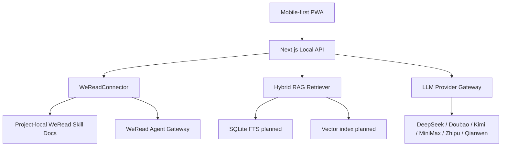

# WeRead Wise Architecture

## Boundary

WeRead Wise is a local-first PWA. The browser renders the mobile app and talks to
local Next.js API routes. API keys are intended to stay server-side.

## Flow

## Extension Points

- `src/lib/weread/connector.ts` keeps UI code independent from the concrete
  WeRead execution path.
- `src/lib/weread/capabilities.ts` maps official skill docs to product-level
  capabilities.
- `src/lib/llm/providers.ts` stores provider metadata without exposing keys to
  the browser.
- `src/lib/rag/retriever.ts` currently uses a local deterministic retriever and
  can be replaced by SQLite FTS, embeddings, and reranking.

## Next Implementation Steps

- Persist books, highlights, projects, conversations, and provider settings in
  SQLite.
- Add encrypted local key storage for WeRead and LLM providers.
- Replace sample RAG with chunking, FTS, embedding, and rerank jobs.
- Add a real command adapter if the official skill is executed by an agent runner
  rather than direct HTTP.
